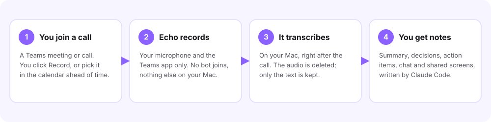
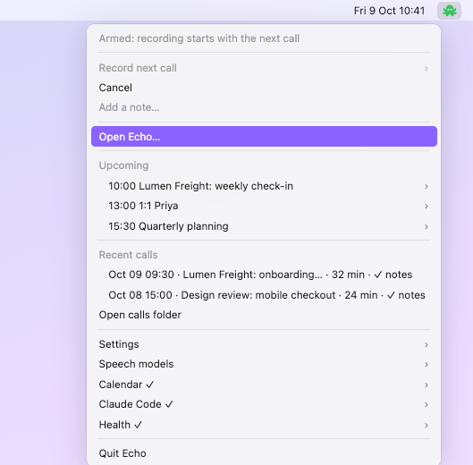
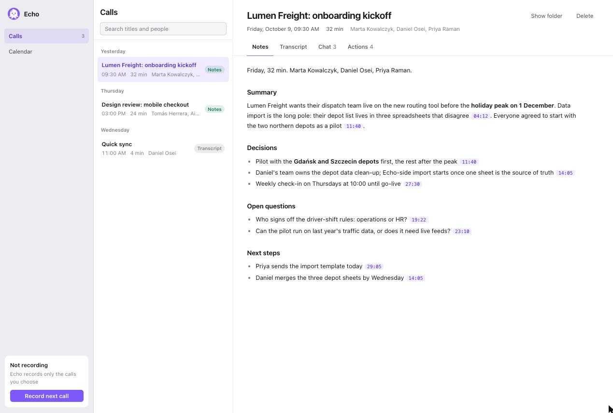
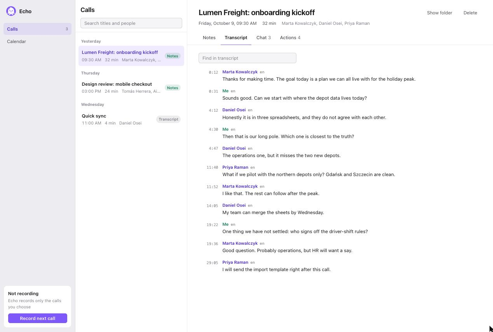
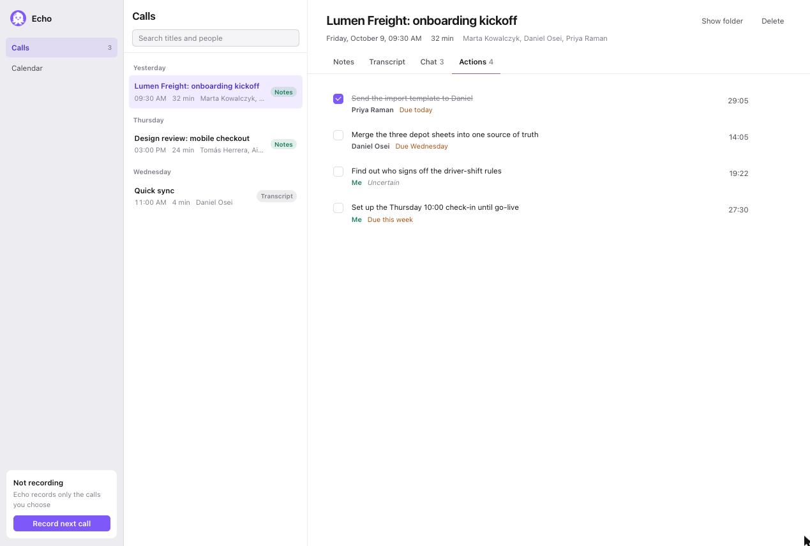
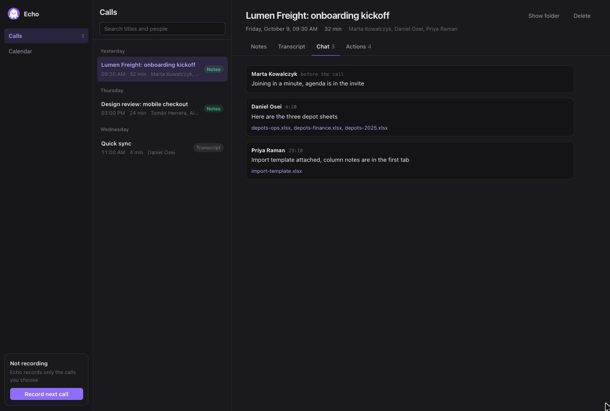
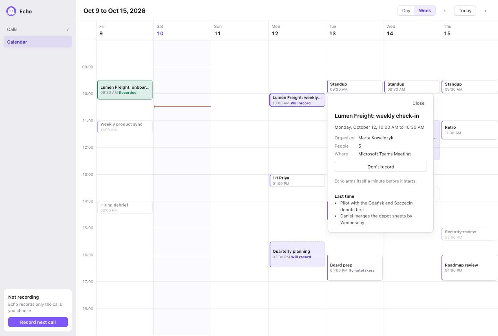

# Echo

**Echo records the Teams calls you choose, turns them into text on your own Mac, and gives you
notes and action items afterwards.** No bot joins the call, nothing is uploaded for
transcription, and the audio is deleted as soon as the transcript is ready.



Echo is two things that work together:

- **The Echo app.** It lives in the menu bar, records the calls you opt in to and writes the
  transcript. It works on its own.
- **Claude Code (optional).** After a call, Claude reads the transcript and writes the notes,
  the action items and follow-up drafts. Without it you still get the full transcript.

macOS 14.2 or later today. Windows is in progress.

---

## 1. Install

1. Download `Echo-<version>.dmg` from [Releases](https://github.com/onetest-ai/echo/releases).
2. Open it and drag **Echo** to **Applications**.
3. Open Echo. On first launch it asks you for three things:
   - **Where to keep your calls.** Pick any folder (for example `~/Echo`). Everything Echo makes
     stays in that folder.
   - **A speech model.** Accept the suggested one. It downloads once (about 0.5 GB), then
     everything runs offline.
   - **Permissions.** macOS asks for *Microphone* (your voice) and *System Audio Recording*
     (the other people in the call, from Teams only). *Accessibility* is optional: with it,
     Echo knows when you mute yourself in Teams and who is speaking.

That's it. The octopus is now in your menu bar.

## 2. Record a call

Echo never records on its own. You decide, per call, in one of two ways:

- **Right now:** click the octopus, then **Record next call**. Echo starts when the Teams call
  starts and stops when it ends.
- **Ahead of time:** open the calendar (step 4) and click **Record** on a meeting. Echo arms
  itself a minute before it starts.

<p align="center"></p>

The icon tells you what is happening: **white** means idle, **green** means armed and waiting
for the call, **orange** means recording.

## 3. Read what was said

Click **Open Echo…** in the menu. Every recorded call is in the list, newest first.

**Notes**: the summary, decisions, open questions and next steps. The small purple times
(`11:40`) jump to that moment in the transcript.



**Transcript**: who said what and when. *Me* is you; the others are named when Teams shows
who is speaking.



**Actions**: the to-dos from the call, with owner and due date. Tick them off as you go.



**Chat**: what people wrote in the meeting chat while the call was on, including the files they
shared, so a link pasted mid-call isn't lost. There's a dark mode too:



There's also a **Screens** tab, if you turn on screen capture in Settings (off by default). It
keeps only the frames where the shared screen actually changed.

## 4. Plan your week

Connect your Microsoft 365 calendar (menu → **Calendar → Connect Microsoft 365**, read-only)
and the **Calendar** view shows yesterday, today and the next five days. Green means recorded,
dashed purple means Echo will record it, and grey means you declined or it was cancelled.
Click a meeting for details, notes from last time, and the Record button.



> Your organisation's IT may need to register an app for you. Put its ID under
> menu → Calendar → Change app (client) ID.

## 5. Get notes from Claude (optional)

Notes, action items and follow-ups are written by [Claude Code](https://claude.com/claude-code).

1. Menu → **Claude Code → Connect Claude Code**. This installs the Echo plugin.
2. Start a new Claude Code session. Nothing else to set up: `/echo:doctor` checks Echo and fixes
   what's missing if something doesn't work.

From then on, notes come two ways:

- **With a Claude Code session open**, it writes the notes when the call ends and offers
  follow-ups, such as a recap email or tasks for your action items. **Nothing is sent without
  your explicit yes.**
- **Without one**, Echo tells you the transcript is ready. Open the call and click **Write
  notes**: Echo runs Claude Code in the background on your Mac, and the notes and action items
  appear a minute or two later. If it fails (for example, Claude Code is signed out), the call
  says why and **Show log** shows what happened.

The model is `sonnet` by default. Change it under menu → Claude Code → **Notes model**: `opus`,
`haiku`, a full model name, or `default` to use whatever your Claude Code is set up with (local
models, a gateway, Bedrock or Vertex). During a
call, `/echo:live` shows the transcript as it happens, and menu → **Add a note…** adds your own notes.

<details>
<summary>Install the plugin by hand, or for one project</summary>

```sh
claude plugin marketplace add onetest-ai/echo
claude plugin install echo@onetest --scope user      # or: project (shared) / local (just you)
```
To keep call notes out of your coding sessions, pick one folder under
menu → Claude Code → Write call notes in.
</details>

---

## Privacy, in short

- **Opt-in per call.** Echo records only calls you armed. Meetings tagged `no_notetakers` are
  marked so you know.
- **On your Mac.** Speech is turned into text locally with [whisper.cpp](https://github.com/ggml-org/whisper.cpp),
  unless you connect Echo to a transcription server yourself (see the FAQ). Then that computer
  hears the audio, and nothing is kept there.
- **Text only.** Audio is deleted once the transcript exists. Calls live in the folder you
  picked, as plain Markdown and JSON.
- **You are responsible for consent.** Tell the people on the call you are taking notes.

## FAQ

**Teams didn't get recorded.** Menu → **Health** shows what's missing, usually a permission.
Permissions belong to Echo in System Settings → Privacy & Security.

**Can I use another language?** Yes. Echo detects the language for each sentence. Menu →
Settings → Languages limits it to the ones you speak, which avoids mix-ups between similar
languages.

**Transcription is slow on my laptop.** Without a graphics card, transcribing takes a long
time. You can let a faster computer on your network do it, such as a Mac with Apple Silicon or
a PC with a graphics card.
1. On the fast computer, open the Echo menu and choose **Settings → Transcribe for other
   computers**. Echo shows a URL and an API key.
2. On the laptop, choose **Settings → Connect to a transcription server…** and enter them.

Each sentence of the call's audio is then sent to that computer, and the text comes back.
The fast computer keeps no audio or text. The connection isn't encrypted, so use it only on a
network you trust. Echo also accepts an `https://` URL, for a server behind a TLS proxy. If the
server can't be reached, the laptop transcribes the call itself. From a terminal, use
`echoctl server use <url> --key <key>` or `echoctl server share on`.

**Where are my files?** In the folder you picked, under `calls/`. Menu → **Open calls folder**.

**How do I update?** When a new version is out, the menu shows **Update to …**. One click
installs it and restarts Echo.

---

## For developers

<details>
<summary>CLI, building, checks</summary>

The app's executable is also a CLI, `echoctl` (menu → Settings → Install command-line tool puts it on
your PATH; on macOS it lives at `/Applications/Echo.app/Contents/MacOS/echoctl`):
`echoctl app [start|quit|autostart on|off|install-cli]`, `echoctl home [set <dir>|choose]`,
`echoctl claude [connect --scope user|project|local]`, `echoctl doctor`,
`echoctl arm|stop|status`, `echoctl model list|download|use|remove`,
`echoctl pending|claim|context` (used by the plugin).

```sh
scripts/build-plugin.sh          # dev build into plugin/bin (the plugin's launcher prefers it)
claude --plugin-dir plugin       # or install it from the repo's marketplace
scripts/package-macos.sh         # signed + notarized Echo.app in a .dmg (see the script header)
scripts/package-windows.ps1      # .msi installer + .zip for Windows
```
Checks: `cargo clippy`, `cargo test`, `cargo check --target x86_64-pc-windows-msvc
--no-default-features`, `scripts/check-mod.sh`. See `CLAUDE.md` for the design.

Windows 10 2004+: double-click `echo-<version>-windows-x64.msi` (per user, no administrator
rights: Start menu, PATH, start at login; upgrades quit and restart Echo; uninstall from
Settings → Apps keeps your calls). The `.zip` has the same files for a manual install.
On Windows the other people
in the call are recorded from the speakers or headset Teams plays on, so other sounds on that
device (other apps, notifications) are recorded too: Windows can't isolate Teams' audio the
way macOS does.
</details>

## License

Echo is **source-available** under the [Functional Source License 1.1](LICENSE.md)
(FSL-1.1-ALv2), with the Apache 2.0 license as its future license. In plain words:

- **You can** use Echo for free: for yourself, for your work calls, inside your company. You can
  read, change and share the code.
- **You can't** sell Echo or offer a competing product or service built on it.
- **Two years after each release**, that release becomes Apache 2.0 open source with no limits.

This is a summary; [LICENSE.md](LICENSE.md) is what counts. For other terms, open an issue.
Third-party components keep their own licenses: see [THIRD-PARTY-NOTICES.md](THIRD-PARTY-NOTICES.md).
The onetest name and octopus logo are trademarks and aren't covered by the license.

## Credits

Echo was inspired by [Granola](https://www.granola.ai), the AI notepad for meetings. It is an
independent project, not affiliated with Granola. The screenshots above use made-up people and
companies.
